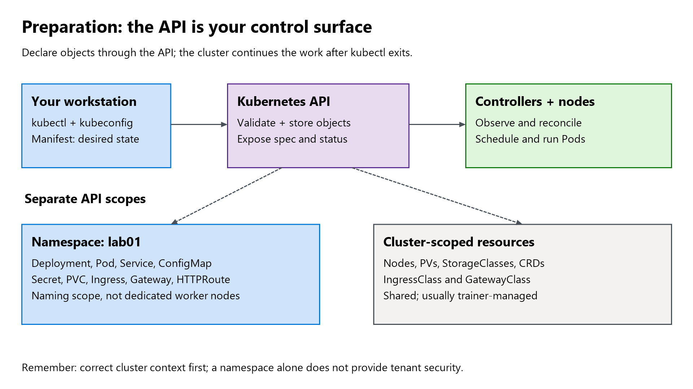

# Preparation

**Duration:** 15 minutes, including a 5-minute refresher.
**Next:** [Deployment / Pods / ReplicaSet](01-deployment-pods-replicaset.md).

## Before you start

The trainer must complete [Instructor setup](../docs/INSTRUCTOR-SETUP.md), including
the AKS/Azure Local version checks, shared controllers, reachable Traefik VIP and
the `managed-csi`/`azurefile-csi` storage classes check. You need PowerShell 7.4+,
Helm and a compatible `kubectl`.
The cluster already exists; this lab does not provision AKS or install its CSI.

Run every command from the **workshop root**, the folder containing
[LAB-GUIDE.md](../LAB-GUIDE.md), not from this `labs` folder. The commands use
root-relative paths such as `.\scripts` and `.\.work`.

Keep the same PowerShell session for the later labs so your variables remain
available. If you open another terminal, restore the variables from the setup
block below with your assigned values; do not rerun workspace/namespace creation.

## Concept refresher: what are you connecting to?

With Docker, you usually send a command to a container engine. With Kubernetes,
you send **API objects describing desired state** to an API server. Controllers
keep comparing that declaration with what exists and take action to reconcile
the difference. `kubectl` can exit while the cluster continues that work.



*Read the picture:* the top row is the management path, not application traffic.
A namespace groups API objects; it is not a separate set of worker nodes.
This and the other lab pictures are original workshop diagrams, not slide
extracts. The source presentation was protected and could not be extracted.

### Objects and terms you will manipulate or inspect

| Object or term | What it means | In this lab |
| --- | --- | --- |
| **Cluster** | The API/control plane plus worker nodes and their running workloads. | Already provided by the trainer; you do not create it. |
| **Control plane / API server** | The API server validates and persists object changes. Control-plane components reconcile workloads and schedule Pods. | The destination of `kubectl`, not the web app's entry point. |
| **Node** (cluster-scoped object) | Represents a worker machine on which Pods can run. Nodes host a container runtime and kubelet, which manages containers for scheduled Pods. | Linux VM workers are already installed on Azure Local. Namespaces share eligible workers. |
| **Namespace** (cluster-scoped object) | Provides a naming scope for namespaced resources. A Pod called `demo` can exist in two different namespaces. | You create or receive `lab01`, `lab02`, etc.; `-n $Namespace` selects it. |
| **Manifest** | A YAML/JSON representation of one or more API objects, not an executable script. | The workspace helper copies manifests; only later `kubectl apply` sends them to the cluster. |
| **kubeconfig / context** | Local connection settings: cluster endpoint, user identity and optional default namespace. Neither is a Kubernetes workload object. | You inspect the selected context to avoid acting on another cluster. |
| **RBAC** | Authorization implemented using Roles/ClusterRoles and bindings. A namespace alone is not a security boundary. | The trainer supplies permissions; you do not create roles or bypass denials. |

### Read an object without memorizing its YAML

- **`apiVersion` + `kind`** identify the API type, for example `apps/v1` and
  `Deployment`; they are not the application's version.
- **`metadata.name`** identifies the object within its resource type/scope.
  **Labels** are key/value tags; **selectors** find matching objects by those tags.
- **`spec`** declares desired configuration. **`status`** is the system's
  observation, including conditions and useful failure reasons. You normally
  author `spec`, not `status`.
- **`kubectl apply`** creates or updates declarations, **`get`** summarizes,
  **`describe`** adds details/events, and **`-o yaml`** shows stored fields.
  A successful API update does not prove a workload is Ready.

**Docker bridge:** a namespace is not a Docker network, and a manifest is not
just another `docker run` command. The distinguishing idea is ongoing
reconciliation after you submit the declaration.

**Recall before typing:** does choosing a namespace choose a worker node?
No: it chooses an API naming scope; scheduling is a separate concern.

## Goal

Connect Docker knowledge to Kubernetes' API and desired-state model, verify your
cluster access and prepare an isolated learner workspace.

```powershell
kubectl config current-context
kubectl version -o yaml
helm version --short
```

The trainer confirms that this is the **workload cluster**, not Resource Bridge,
and that your client version is compatible. Every command below names your
namespace explicitly; no global context namespace changes are needed.

## Set up your namespace and files

Set your assigned namespace. The storage classes default to the AKS built-in
classes used by the Volumes lab:

```powershell
$Namespace = 'lab01'                  # Every learner/pair uses a different name.
$RwoStorageClass = 'managed-csi'      # Azure Disk, ReadWriteOnce
$RwxStorageClass = 'azurefile-csi'    # Azure Files, ReadWriteMany
$LabHost = "$Namespace.lab.test"
$HelmHost = "helm.$Namespace.lab.test"
$LabFiles = ".\.work\$Namespace"

.\scripts\New-LabWorkspace.ps1 -Namespace $Namespace -RwoStorageClass $RwoStorageClass -RwxStorageClass $RwxStorageClass
kubectl create namespace $Namespace
kubectl -n $Namespace get pods
```

If namespaces are pre-created, skip `kubectl create namespace`. Change the two
storage class names only if the trainer tells you to; for example AKS on Azure
Local does not provide `managed-csi`/`azurefile-csi`. The helper only
copies/substitutes local YAML.

**Do not apply the whole generated directory.** Follow the file-by-file sequence.
The original examples use namespace/host `lab01`; generated examples are yours
to edit without affecting another learner.

Use only synthetic content. Never put passwords, patient information or other
sensitive data into the page, terminal examples or public web directory.
Stop at unexpected errors: PowerShell does not automatically stop when a native
command returns a nonzero exit code.

## Read your first manifest

Open [the example Deployment](../manifests/01-app/deployment.yaml). Identify:

- `apiVersion`, `kind`, `metadata`, `spec`;
- Deployment replicas and selector;
- the Pod template and its labels;
- the container image, exposed container port, probes and resources.

**Checkpoint:** explain which parts resemble `docker run`, and which parts
describe a controller rather than a container.

## Completion checkpoint

- Correct workload context and compatible client confirmed.
- Your assigned namespace exists and is accessible.
- Your generated manifests are in `.work\<your-namespace>`.
- `$Namespace`, `$RwoStorageClass`, `$RwxStorageClass`, `$LabHost`, `$HelmHost`
  and `$LabFiles` are set.

Leave the namespace in place for the next lab.

[Lab index](../LAB-GUIDE.md) | [Next: Deployment / Pods / ReplicaSet](01-deployment-pods-replicaset.md)
