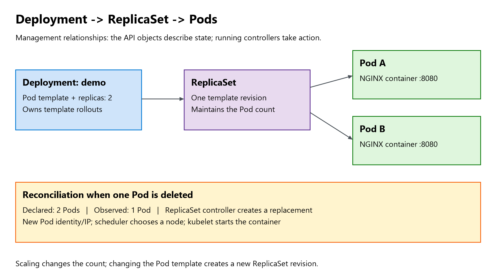
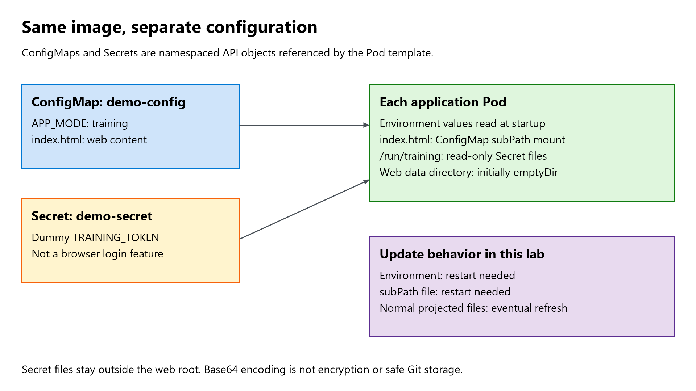

# Deployment / Pods / ReplicaSet

**Duration:** 50 minutes, including a 5-minute refresher, ConfigMaps and Secrets.
**Prerequisite:** [Preparation](00-preparation.md).
Run commands from the workshop root in the same PowerShell session.

## Goals

- Create a Deployment and trace its ReplicaSet/Pod ownership.
- Observe reconciliation and change the replica count.
- Inject and update ConfigMaps and Secrets without rebuilding an image.

No Service or ingress is required yet. Network exposure is covered in
[Service / Ingress / Gateway API](02-service-ingress-gatewayapi.md).

## Concept refresher: from an image to a managed application

A container image is the packaged application. A **Pod** is Kubernetes' smallest
schedulable workload unit: one or more containers that share networking and can
share volumes. Our Pod has one NGINX container. Rather than manually keeping
Pods alive, you declare a **Deployment** and let its controllers manage them.



*Read the picture:* arrows show management/ownership, not network traffic.
Objects store the declarations; the corresponding running controllers do the
work. You create the Deployment; Kubernetes creates its ReplicaSet and Pods.

### Objects you will manipulate or inspect

All the application objects below are **namespaced**.

| Object | Purpose | In this lab |
| --- | --- | --- |
| **Deployment** | Declares a Pod template, replica count and rollout policy. Its controller manages ReplicaSets. | `demo` starts with two replicas; scaling changes its desired count. |
| **ReplicaSet** | Maintains the requested number of matching Pods for a particular template revision. | Created by the Deployment. You inspect it, not independently create/scale it. |
| **Pod** | Runs containers together on one node. A Pod has its own identity/IP and is disposable. | Deleting one results in a new Pod with a different name/UID, not resurrection of the deleted object. |
| **ConfigMap** | Stores non-confidential configuration as keys or files, separately from an image. | `demo-config` supplies `APP_MODE` and the web page. |
| **Secret** | Stores sensitive data behind Kubernetes access controls; it is not encrypted merely because it is a Secret. | `demo-secret` supplies a **dummy** token via environment and a read-only file. |
| **Event** | A short-lived API record describing observations such as scheduling, image pulls or mount failures. | Shown by `describe` to help explain why a Pod is not Ready. It is not a durable audit log. |

**Not separate objects:** containers, `replicas`, probes, resource requests,
volume mounts, labels and the Pod template are fields within these objects.
An **image** is a registry artifact, not a Kubernetes API object.

### What happens after `apply`?

1. The API accepts the Deployment declaration.
2. The Deployment controller creates a ReplicaSet for the Pod template.
3. The ReplicaSet controller creates the required Pods.
4. The scheduler assigns each unscheduled Pod to an eligible node; the node's
   kubelet starts its containers and runs health checks.
5. Controllers continue reconciling. If a Pod disappears, the ReplicaSet
   controller replaces it. If a container crashes within an existing Pod, the
   kubelet can restart that container instead.

Changing the **Pod template** (image, environment or a restart annotation)
triggers a rollout through a new ReplicaSet. Changing only `replicas` scales
without a new template revision. Old ReplicaSets can remain at zero replicas.
Do not edit generated Pods or ReplicaSets to make a permanent Deployment change.

### Configuration and storage inside the Pod



*Read the picture:* references inject configuration into each new Pod; they do
not rebuild the image. The Secret file is outside the directory NGINX serves.
The `data` volume starts as `emptyDir`; the Volumes lab later replaces it.

| Pod field | Why it matters here |
| --- | --- |
| `labels` / `selector.matchLabels` | Connect the controllers to their Pods. These labels will also let a Service find the app in the next lab. |
| `env.valueFrom` | Reads a named ConfigMap/Secret key at container startup; later API updates do not rewrite an existing process's environment. |
| `volumes` / `volumeMounts` | Define a volume source and where the container sees it. This is the Kubernetes counterpart of mounted configuration, not an embedded image file. |
| `subPath` | Mounts only `index.html` rather than replacing the whole web directory. This specific mount does **not** auto-refresh after a ConfigMap update. |
| Readiness probe | Determines whether the container is ready to serve; an unready Pod normally is not used as a ready Service backend. |
| Liveness probe | Detects a stuck/unhealthy container and can cause a container restart. It does not create a new Deployment. |
| CPU/memory requests and limits | Requests influence scheduling; limits bound runtime use. `50m` is 0.05 CPU and `32Mi` is 32 mebibytes, not replica counts. |
| `securityContext` | Configures process identity and privileges. This app runs as UID/GID 101 with privilege escalation disabled. |

**Docker bridge:** the image, environment and mount paths will feel familiar.
The new layer is the Deployment -> ReplicaSet -> Pod ownership chain.

**Recall before typing:** which change recreates a Pod template revision:
scaling from two to three replicas, or changing the image? The image change.

## 1. Create supporting objects, then the workload

For now, treat ConfigMap and Secret as prerequisites; section 3 explains them.

```powershell
kubectl -n $Namespace apply -f "$LabFiles\01-app\configmap.yaml"
kubectl -n $Namespace apply -f "$LabFiles\01-app\secret.yaml"
kubectl -n $Namespace apply -f "$LabFiles\01-app\deployment.yaml"
kubectl -n $Namespace rollout status deployment/demo --timeout=180s
kubectl -n $Namespace get deployment,replicaset,pod -l app=demo -o wide
kubectl -n $Namespace logs deployment/demo --tail=15
```

Expected: one Deployment, a ReplicaSet and **two Ready Pods**. The image runs as
UID 101 and listens on 8080; it does not require root or a privileged Pod.

```powershell
$PodName = kubectl -n $Namespace get pods -l app=demo -o jsonpath='{.items[0].metadata.name}'
kubectl -n $Namespace describe pod $PodName
kubectl -n $Namespace get pod $PodName -o jsonpath='{.metadata.ownerReferences[0].kind}'
```

Expected owner: `ReplicaSet`. The ReplicaSet in turn belongs to the Deployment.
The scheduler places Pods; the Deployment/ReplicaSet controllers maintain them.

## 2. Delete a Pod, then scale

```powershell
kubectl -n $Namespace delete pod $PodName
kubectl -n $Namespace get pods -l app=demo -w
```

Watch a replacement appear; Ctrl+C after two Pods are Ready. The replacement has
a new name/UID. Kubernetes did not restart the deleted object; it created a new
Pod to match desired replicas.

```powershell
kubectl -n $Namespace scale deployment/demo --replicas=3
kubectl -n $Namespace rollout status deployment/demo --timeout=180s
kubectl -n $Namespace get pods -l app=demo
kubectl -n $Namespace scale deployment/demo --replicas=2
kubectl -n $Namespace rollout status deployment/demo --timeout=180s
```

**Question:** if you reapply YAML that says `replicas: 2`, what happens to a
manual scale to 3? Answer: the declaration wins when reapplied.

## 3. ConfigMap and Secret

### 3.1 Inspect the references, not just the resources

Open your generated ConfigMap, Secret and Deployment. Find:

- `configMapKeyRef`: `APP_MODE` injected into the process environment.
- A ConfigMap file mounted as `index.html` using `subPath`.
- `secretKeyRef`: `TRAINING_TOKEN` injected as an environment variable.
- A read-only Secret volume mounted at `/run/training`.

```powershell
kubectl -n $Namespace get configmap demo-config
kubectl -n $Namespace describe secret demo-secret
kubectl -n $Namespace exec deployment/demo -- printenv APP_MODE
kubectl -n $Namespace exec deployment/demo -- sh -c 'if [ -n "$TRAINING_TOKEN" ] && [ -s /run/training/TRAINING_TOKEN ]; then echo "Secret present; value not displayed"; else echo "Secret missing" >&2; exit 1; fi'
```

Expected: `training` and a presence confirmation. Do not run unrestricted
`printenv` or dump a real Secret's YAML. The token is deliberately **not** mounted
inside `/usr/share/nginx/html`, and is never returned by the demo page.
The demonstration token is not an authentication feature of the web application.

### 3.2 Change config without rebuilding an image

Edit your generated ConfigMap:

- `APP_MODE: workshop-v2`
- Change page `Version: 1` to `Version: 2`.

```powershell
kubectl -n $Namespace apply -f "$LabFiles\01-app\configmap.yaml"
kubectl -n $Namespace exec deployment/demo -- printenv APP_MODE
```

Expected: the existing container still reports `training`. Its environment was
set at startup. The `subPath` file also does **not** get automatic projection
updates. Roll out new Pods:

```powershell
kubectl -n $Namespace rollout restart deployment/demo
kubectl -n $Namespace rollout status deployment/demo --timeout=180s
kubectl -n $Namespace exec deployment/demo -- printenv APP_MODE
kubectl -n $Namespace exec deployment/demo -- wget -qO- http://127.0.0.1:8080/
```

Expected: `workshop-v2` and page version 2. The container image is unchanged.
The HTTP check runs inside a Pod against its own web server; it does not depend
on a Service that you have not created yet.

### 3.3 Rotate the demonstration token

Edit `stringData.TRAINING_TOKEN` in your generated Secret to another **dummy**
value, apply it and restart the Deployment:

```powershell
kubectl -n $Namespace apply -f "$LabFiles\01-app\secret.yaml"
kubectl -n $Namespace rollout restart deployment/demo
kubectl -n $Namespace rollout status deployment/demo --timeout=180s
```

Important distinctions:

- `stringData` is convenient authoring input; the API stores Secret data in its
  encoded representation. **Base64 is not encryption.**
- YAML containing a real credential is still a credential disclosure. Do not
  commit it, log it or put it in Helm values/history.
- Environment values require a restart. Normal projected ConfigMap/Secret
  volumes can refresh eventually; `subPath` mounts do not auto-refresh. An
  application may also need to reload an updated file.
- Secret RBAC, at-rest encryption and a secret manager are separate controls.
  Do not assume their configuration from the existence of a Secret object.

**Checkpoint:** explain why two Pods can run the same image with different
configuration, and why a Secret is not simply a secure Git configuration file.

## Completion checkpoint

- Deployment `demo` has two Ready Pods managed through a ReplicaSet.
- Deleting a Pod creates a replacement; scaling changes the desired count.
- The running app reports `workshop-v2` and page version 2.
- ConfigMap and Secret injection is understood without exposing secret values.

Leave these objects in place. The next lab creates the Service and routes.

[Previous: Preparation](00-preparation.md) | [Lab index](../LAB-GUIDE.md) | [Next: Service / Ingress / Gateway API](02-service-ingress-gatewayapi.md)
