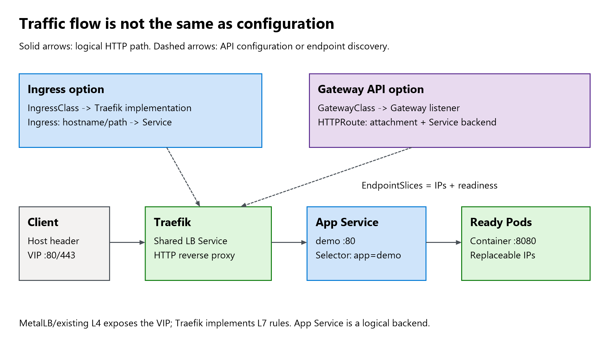

# Service / Ingress / Gateway API

**Duration:** 50 minutes, including a 5-minute refresher.
**Prerequisite:** [Deployment / Pods / ReplicaSet](01-deployment-pods-replicaset.md),
with two Ready Pods and page version 2.
Run commands from the workshop root in the same PowerShell session.

## Goals

- Discover Pods through a stable Service and DNS name.
- Diagnose an incorrect Service selector.
- Expose the same backend through Ingress and Gateway API.
- Distinguish Kubernetes API objects, the L7 controller and L4 load balancing.

## Concept refresher: stable discovery versus HTTP routing

Pod IPs change when Pods are replaced. A **Service** gives clients a stable
network identity while its backend endpoints change. **Ingress** and
**Gateway API** add HTTP hostname/path routing in front of Services; they do
not replace the need for running controllers or reachable networking.



*Read the picture:* solid arrows show the logical traffic path; dashed arrows
show API configuration/discovery, not packets passing through those objects.
Traefik may connect directly to discovered Pod endpoints rather than send each
request through the Service's virtual IP. EndpointSlices describe those
endpoints; an EndpointSlice is not a proxy.

### Objects you will manipulate or inspect

| Object or component | Scope | Purpose and role in the exercise |
| --- | --- | --- |
| **Service `demo`** | Namespace | Stable ClusterIP/DNS and port mapping to Pods selected by `app=demo`. `port: 80` maps to the named `http` container port 8080. |
| **EndpointSlice** | Namespace | Controller-maintained backend IPs, ports and readiness for a Service. You inspect these; do not maintain Pod IPs manually. |
| **Traefik LoadBalancer Service** | Namespace `traefik` | The shared outside-facing Service on VIP ports 80/443, distinct from your app's ClusterIP Service. |
| **IngressClass `traefik`** | Cluster | Identifies the controller responsible for a standard Ingress. It is shared and trainer-owned. |
| **Ingress `demo`** | Namespace | Host/path rules mapping your hostname to Service `demo`, port 80. It does not itself process HTTP. |
| **GatewayClass `traefik`** | Cluster | Selects the implementation/controller for Gateways. Also shared and trainer-owned; not the same type as IngressClass. |
| **Gateway `demo`** | Namespace | Declares listeners: hostname, protocol, port and which routes may attach. |
| **HTTPRoute `demo`** | Namespace | Attaches to the Gateway using `parentRefs` and declares HTTP matches and Service backends. |
| **CRD** | Cluster | Registers a custom API type. GatewayClass, Gateway and HTTPRoute need the installed Gateway API CRDs; Service and Ingress are built-in APIs. |
| **Traefik controller/data plane** | Runs in Pods | Watches the routing objects and configures the actual reverse proxy. It is software, not an Ingress/Gateway object. |
| **MetalLB or existing L4 implementation** | Platform-managed | Allocates/advertises the Service VIP using the approved site network design. It does not interpret HTTP paths. |

The cluster DNS service gives `demo` its in-namespace Service name.
`curl.exe --resolve` instead supplies a **workstation-side hostname/IP mapping**
for the outside-facing test; it does not create a Kubernetes DNS object.

### Compare the exposure layers

| Layer | What it solves | What it does not solve |
| --- | --- | --- |
| `ClusterIP` Service | Stable in-cluster discovery/transport to an app | Workstation access by itself |
| `LoadBalancer` Service | Requests outside-facing L4 exposure from an implementation | HTTP hostname/path rules, or an IP when no working implementation/pool exists |
| Ingress + IngressClass | A compact HTTP routing declaration and controller selection | Controller installation, IP allocation or DNS setup |
| GatewayClass + Gateway + HTTPRoute | Separates implementation, listener ownership and app routing | A data plane without a controller, or automatic site network configuration |

`NodePort`, another Service type, exposes a node-level port; it is not used
directly in this lab. `containerPort` alone does not publish a port as Docker's
`-p` does. In this Traefik setup, listener port **8000** is the internal `web`
entry point while clients use VIP port **80**; that mapping is implementation
configuration, not a universal Gateway API rule.

### Read attachment and readiness as well as YAML

Ingress uses `ingressClassName`. Gateway API uses `gatewayClassName`,
`parentRefs` and listener `allowedRoutes`; matching names alone are not enough
if a route is not allowed to attach. This lab keeps Gateway, HTTPRoute and
backend Service in the same namespace, so no cross-namespace ReferenceGrant
is needed.

`Accepted` means a declaration/attachment is accepted, `ResolvedRefs` means
referenced resources can be resolved, and Gateway `Programmed` indicates
configuration has been programmed. Inspect condition reasons/messages and still
make an HTTP request: none is a substitute for a real end-to-end traffic test.

**Docker bridge:** port publishing gets traffic to one host/container; here,
L4 exposure, HTTP routing and app discovery are separate responsibilities.

**Recall before typing:** if Pods are Ready but a Service selector matches
nothing, will changing Ingress rules repair it? No; first fix the endpoints.

## 1. Give the application a stable address

```powershell
kubectl -n $Namespace apply -f "$LabFiles\01-app\service.yaml"
kubectl -n $Namespace get service demo
kubectl -n $Namespace get endpointslice -l kubernetes.io/service-name=demo
```

Trace `Service port 80 -> targetPort http -> container port 8080`. The Service
selects Pods by label; it does not reference a Deployment by name. Ready Pod
endpoints change while the Service identity remains stable.

In terminal A:

```powershell
kubectl -n $Namespace port-forward service/demo 8080:80
```

In terminal B:

```powershell
curl.exe --fail --noproxy "*" http://localhost:8080/
```

Expected: `Kubernetes hands-on lab`, version 2 after the configuration exercise.
A Service port-forward ultimately selects a Pod and tunnels through the API
server. This is **not a test of the VIP, the Service's load balancing, or
Ingress**. Restart the tunnel if that Pod is replaced.

The in-cluster DNS name is `demo.<your-namespace>.svc.cluster.local`. From a Pod:

```powershell
kubectl -n $Namespace exec deployment/demo -- wget -qO- http://demo/
```

## 2. A small, reversible failure

Stop port-forward with Ctrl+C. Change only the Service selector:

```powershell
kubectl -n $Namespace set selector service/demo app=does-not-exist
kubectl -n $Namespace get pods -l app=demo
kubectl -n $Namespace describe service demo
kubectl -n $Namespace get endpointslice -l kubernetes.io/service-name=demo -o yaml
```

Expected: Pods remain Ready, but no matching endpoints are available. Repair:

```powershell
kubectl -n $Namespace apply -f "$LabFiles\01-app\service.yaml"
kubectl -n $Namespace get endpointslice -l kubernetes.io/service-name=demo
kubectl -n $Namespace exec deployment/demo -- wget -qO- http://demo/
```

**Checkpoint:** explain why restarting all containers would not fix this.

## 3. Route with an Ingress

The trainer has installed Traefik and arranged a reachable L4 address. Write it
here; do not use the control-plane IP:

```powershell
$IngressIp = '<trainer-supplied-Traefik-VIP>'
```

```powershell
kubectl -n $Namespace apply -f "$LabFiles\02-network\ingress.yaml"
kubectl -n $Namespace get ingress demo
kubectl -n $Namespace describe ingress demo
curl.exe --fail --noproxy "*" --resolve "${LabHost}:80:${IngressIp}" "http://${LabHost}/"
```

Expected: page version 2. `--resolve` sets both the connection address and the
correct hostname without changing Windows' hosts file or corporate DNS.
The Ingress address/status column may not be populated by every controller;
the decisive test is an HTTP request through the real VIP.

```powershell
curl.exe --noproxy "*" --resolve "not-configured.lab.test:80:${IngressIp}" http://not-configured.lab.test/
```

In the dedicated training setup this should return Traefik's 404, not your app.
You deliberately changed the HTTP host, not the Pod image.

Identify:

- `IngressClass`: selects the controller implementation.
- `Ingress`: host/path rule targeting Service port 80.
- Traefik's separate `LoadBalancer` Service: the shared reachable entry point.
- Your `demo` Service: remains ClusterIP.

## 4. Express the same route with Gateway API

Remove the Ingress first to avoid competing routes for the same hostname:

```powershell
kubectl -n $Namespace delete ingress demo
kubectl -n $Namespace apply -f "$LabFiles\02-network\gateway.yaml"
kubectl -n $Namespace apply -f "$LabFiles\02-network\httproute.yaml"
kubectl -n $Namespace wait --for=condition=Programmed gateway/demo --timeout=120s
kubectl -n $Namespace describe gateway demo
kubectl -n $Namespace describe httproute demo
curl.exe --fail --noproxy "*" --resolve "${LabHost}:80:${IngressIp}" "http://${LabHost}/"
```

Check the HTTPRoute's **parent status**: `Accepted=True` and
`ResolvedRefs=True`. A resource being created is not proof it routes traffic.
If conditions are false, read their Reason/Message.

| Object | Responsibility in this exercise |
| --- | --- |
| GatewayClass `traefik` | Shared, cluster-scoped controller selection; trainer-owned |
| Gateway `demo` | Namespaced listener, host and allowed route attachment |
| HTTPRoute `demo` | App host/path rule and Service backend |
| Service `demo` | Stable L4 access to Ready Pods |

The Gateway listener uses **8000** because it matches this Traefik entry point;
the client still uses VIP port **80**. This is a controller-specific mapping.
`allowedRoutes: Same` means same namespace, so no ReferenceGrant is needed.
The shared Traefik controller implements these Gateways; each Gateway here does
not create a new appliance or a separate LoadBalancer Service.

**Challenge:** change only `backendRefs.name` to a nonexistent Service, apply,
inspect `ResolvedRefs=False`, then restore `demo` and retest. Do not proceed
until routing works again.

Restore Ingress for the Volumes lab and later optional TLS exercise:

```powershell
kubectl -n $Namespace delete -f "$LabFiles\02-network\httproute.yaml"
kubectl -n $Namespace delete -f "$LabFiles\02-network\gateway.yaml"
kubectl -n $Namespace apply -f "$LabFiles\02-network\ingress.yaml"
curl.exe --fail --noproxy "*" --resolve "${LabHost}:80:${IngressIp}" "http://${LabHost}/"
```

**Checkpoint:** name the API resources and running components involved from
workstation to container. Which pieces would be absent if you applied only an
HTTPRoute to a fresh cluster?

## Completion checkpoint

- Service `demo` has Ready endpoints and its DNS name works inside the namespace.
- Routing was tested through both Ingress and Gateway API using the real VIP.
- `$IngressIp` is set for later labs.
- Ingress `demo` is restored; the exercise's Gateway/HTTPRoute are removed.

[Previous: Deployment / Pods / ReplicaSet](01-deployment-pods-replicaset.md) | [Lab index](../LAB-GUIDE.md) | [Next: Volumes](03-volumes.md)
