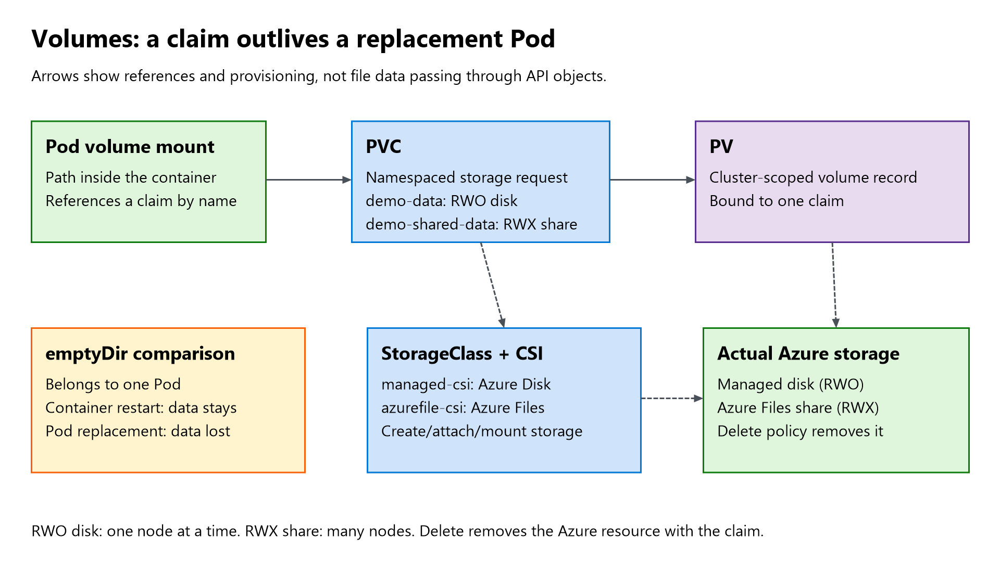

# Volumes

**Duration:** 45 minutes, including a 5-minute refresher.
**Prerequisite:** [Service / Ingress / Gateway API](02-service-ingress-gatewayapi.md),
with a working Ingress and `$IngressIp` set.
Run commands from the workshop root in the same PowerShell session.

## Goals

- Compare Pod-scoped `emptyDir` with persistent storage.
- Request an Azure Disk through a PVC (`managed-csi`) and inspect its PV and StorageClass.
- Prove data survives Pod replacement.
- Share one Azure Files volume between replicas (`azurefile-csi`, RWX).
- Understand access modes and watch the `Delete` reclaim policy remove a disk.

## Concept refresher: where does a file actually live?

A container's writable layer is not durable application storage. Kubernetes
**volumes** give containers a mounted filesystem, but their lifetimes depend on
the volume source. An `emptyDir` belongs to one Pod; persistent storage is
requested separately through a **PersistentVolumeClaim**.



*Read the picture:* arrows show references and provisioning, not a chain of
network proxies that file data passes through. The Pod sees a mounted path;
the CSI driver and node arrange the mount to the actual backend.
This lab uses the AKS built-in classes `managed-csi` (Azure Disk) and
`azurefile-csi` (Azure Files); both are described below.

### Objects and fields you will manipulate or inspect

| Object or field | Scope | Purpose and role in the exercise |
| --- | --- | --- |
| **Pod `volumes` / `volumeMounts`** | Fields in a namespaced Pod template | Connect a named volume source to a container path. These are not standalone API objects. |
| **`emptyDir`** | Pod-lifetime volume source | Initially backs the public `data` directory. Survives a container restart in that Pod; lost when that Pod is removed. |
| **PVC: PersistentVolumeClaim** | Namespace | An app's request for capacity, access mode and optional StorageClass. You create `demo-data` (Azure Disk, RWO) and `demo-shared-data` (Azure Files, RWX). |
| **PV: PersistentVolume** | Cluster | Describes a provisioned storage resource and its binding to a claim, backend reference, capacity and reclaim policy. The PV object is not the actual disk/share. |
| **StorageClass** | Cluster | Defines a provisioning policy: provisioner/parameters, reclaim policy and binding behavior. It is a recipe, not a volume or a pool of already mounted files. |
| **CSI driver / CSIDriver** | Driver software / cluster API object | CSI software implements storage operations; a CSIDriver object advertises driver capabilities. Creating that object alone does not install a working driver. |
| **Event** | Namespace for the Pod/PVC events here | Explains provisioning, attach, scheduling or mount failures. Read the reason/message rather than assuming every Pending PVC is broken. |
| **Deployment patch** | Change to an existing namespaced Deployment | Replaces the `data` volume source: first with the disk claim (one replica, Recreate), then with the shared file claim (two replicas, RollingUpdate). The patch file itself is not a new Kubernetes object. |

### Dynamic versus static provisioning

**Dynamic path used in this lab:** create a PVC that names `managed-csi` or
`azurefile-csi`.
The provisioner creates backing storage and a PV; Kubernetes binds the PVC/PV,
and the consuming Pod can mount it. With `WaitForFirstConsumer`, provisioning
or binding waits for scheduling information from a consuming Pod. That is why
the instructions do not wait for Bound before creating the consumer.

**Static provisioning (concept only):** an administrator first provides existing
storage, for example an existing Azure disk, Azure file share or NFS export, and
creates a PV pointing at it. Its `claimRef` reserves it; the PVC's
`volumeName` selects it. `storageClassName: ""` avoids accidentally using the
default dynamic class. No new storage is created merely by writing this PV YAML.

### Access mode, lifecycle and permissions are different questions

| Concept | Meaning to remember |
| --- | --- |
| `ReadWriteOnce` (RWO) | Read/write mounting by one node; not necessarily only one Pod. One replica plus Recreate avoids overlapping rollout consumers here. |
| `ReadWriteMany` (RWX) | Supports read/write mounts from multiple nodes when the backend/driver allows it. Does not make concurrent file writes safe for the application. |
| `Delete` reclaim policy | After claim release/deletion, supported provisioning normally deletes the PV and backing volume. Treat deletion as potentially destructive. |
| `Retain` reclaim policy | Leaves storage for administrator-led recovery/reclamation. It does not provide automated rebinding or backups. |
| UID/GID, ACLs and `fsGroup` | Determine whether the mounted filesystem is writable by this app (UID/GID 101). A Bound PVC does not prove filesystem permissions are correct. |

Pod deletion leaves a separately existing PVC/PV intact; namespace deletion
deletes its PVCs and can trigger backend deletion. None of these policies
replaces backup or disaster recovery.

### The two AKS storage classes used in this lab

AKS in Azure creates these classes automatically when its Azure Disk and Azure
Files CSI drivers are enabled (the default). You only reference them by name.

| | `managed-csi` | `azurefile-csi` |
| --- | --- | --- |
| Backing storage | Azure managed disk, Standard SSD (zone-redundant on multi-zone clusters) | Azure Files SMB share in a Standard storage account |
| CSI driver | `disk.csi.azure.com` | `file.csi.azure.com` |
| Access mode | RWO: the disk is attached to one node at a time | RWX: Pods on many nodes mount the same share |
| Binding | `WaitForFirstConsumer`: created where the first Pod is scheduled | `Immediate`: created as soon as the claim exists |
| Reclaim policy | `Delete`: deleting the claim deletes the Azure disk | `Delete`: deleting the claim deletes the file share |
| Permissions for UID 101 | Kubelet applies the Pod's `fsGroup: 101` | The SMB mount uses permissive file/directory modes |
| Typical use | Single-writer data such as a database | Shared content, many readers/writers |
| In this lab | `demo-data`, 4Gi (smallest Standard SSD billing tier) | `demo-shared-data`, 5Gi |

Both classes create real, billed Azure resources in the cluster's node resource
group (`MC_...`). The `Delete` policy removes them when you delete the claim.

**AKS on Azure Local** does not provide these two classes. There, the trainer
supplies equivalent validated classes, and the Preparation variables
`$RwoStorageClass` / `$RwxStorageClass` carry their names into your files; the
commands below stay the same.

**Docker bridge:** a PVC is closer to an app requesting a named volume than
binding a host path. A PV/CSI backend adds provisioning, attachment and lifecycle
management across nodes.

**Recall before typing:** can you prove persistence by restarting only a
container in the same Pod? No; replace the Pod while keeping the same claim.

## 1. First, lose data with an emptyDir

Use one replica so a request/exec cannot accidentally target a different Pod:

```powershell
kubectl -n $Namespace scale deployment/demo --replicas=1
kubectl -n $Namespace rollout status deployment/demo --timeout=180s
kubectl -n $Namespace exec deployment/demo -- sh -c 'echo "temporary data" > /usr/share/nginx/html/data/note.txt'
kubectl -n $Namespace exec deployment/demo -- cat /usr/share/nginx/html/data/note.txt
kubectl -n $Namespace rollout restart deployment/demo
kubectl -n $Namespace rollout status deployment/demo --timeout=180s
kubectl -n $Namespace exec deployment/demo -- sh -c 'if [ -f /usr/share/nginx/html/data/note.txt ]; then echo "Unexpected: file still exists" >&2; exit 1; else echo "Expected: replacement Pod has no note.txt"; fi'
```

Expected: the file is gone. `emptyDir` survives a container restart inside the
same Pod, **not** replacement of that Pod.

## 2. Request an Azure Disk with `managed-csi`

First read the class you are about to use. Learners without cluster-scoped read
access can watch the trainer run these two commands:

```powershell
kubectl get storageclass $RwoStorageClass $RwxStorageClass
kubectl get storageclass $RwoStorageClass -o yaml
```

Find the provisioner (`disk.csi.azure.com`), the disk SKU parameter,
`reclaimPolicy: Delete`, `volumeBindingMode: WaitForFirstConsumer` and
`allowVolumeExpansion: true`. Then create the claim:

```powershell
kubectl -n $Namespace apply -f "$LabFiles\03-storage\pvc-managed-csi.yaml"
kubectl -n $Namespace get pvc demo-data
kubectl -n $Namespace describe pvc demo-data
```

Expected: **Pending** with an event such as *waiting for first consumer to be
created before binding*. No Azure disk exists yet. That is normal for
`WaitForFirstConsumer`: the disk will be created in the zone of the node where
the first consuming Pod is scheduled.

Now make the Deployment consume the claim:

```powershell
kubectl -n $Namespace patch deployment demo --type strategic --patch-file "$LabFiles\03-storage\use-managed-csi.patch.yaml"
kubectl -n $Namespace rollout status deployment/demo --timeout=300s
kubectl -n $Namespace get pvc demo-data
kubectl -n $Namespace describe pvc demo-data
```

The patch replaces `emptyDir` with a PVC reference, sets one replica and uses
`Recreate`. It is a **patch**, not a resource for `kubectl apply`. Creating and
attaching the disk to the node typically takes 30-90 seconds.

Expected: PVC `Bound`, Deployment available, one Ready Pod. If provisioning or
mounting fails:

```powershell
kubectl -n $Namespace get pods -l app=demo
kubectl -n $Namespace describe pvc demo-data
kubectl -n $Namespace get events --sort-by=.metadata.creationTimestamp
```

Do not "fix" this by switching to hostPath, privileged containers, chmod 777 or
another StorageClass. Ask the trainer to read the events: typical causes are an
Azure quota, the node's data-disk limit, a zone constraint or a disabled CSI driver.

If you can read cluster-scoped storage resources (otherwise trainer demo):

```powershell
$PvName = kubectl -n $Namespace get pvc demo-data -o jsonpath='{.spec.volumeName}'
kubectl get pv $PvName
kubectl get pv $PvName -o jsonpath='{.spec.csi.driver}{"\n"}{.spec.csi.volumeHandle}{"\n"}'
kubectl get volumeattachment
```

Find its claim reference, storage class, access mode and reclaim policy. The
`volumeHandle` is the Azure resource ID of the managed disk, located in the node
resource group (`MC_...`). The **VolumeAttachment** shows which node the RWO disk
is attached to. The PV is cluster-scoped; the PVC is namespaced.

## 3. Prove persistence across Pod replacement

```powershell
kubectl -n $Namespace exec deployment/demo -- sh -c 'echo "This file lives on my Azure Disk" > /usr/share/nginx/html/data/note.txt'
kubectl -n $Namespace get pods -l app=demo -o wide
kubectl -n $Namespace rollout restart deployment/demo
kubectl -n $Namespace rollout status deployment/demo --timeout=300s
kubectl -n $Namespace get pods -l app=demo -o wide
kubectl -n $Namespace exec deployment/demo -- cat /usr/share/nginx/html/data/note.txt
curl.exe --fail --noproxy "*" --resolve "${LabHost}:80:${IngressIp}" "http://${LabHost}/data/note.txt"
kubectl -n $Namespace get pvc demo-data
```

Expected: new Pod, **same PVC/PV**, same file contents returned through Ingress.
If the new Pod landed on another node, Kubernetes detached the disk from the
old node and attached it to the new one; that is why the rollout uses
`Recreate` and can take a minute. Do not put secrets in this publicly served
data directory.

Discuss:

- RWO means read/write by one **node**, not necessarily only one Pod.
- Single replica + Recreate avoids overlapping rollout consumers here, but is
  not high availability. Do not scale this RWO example to multiple nodes.
- Deleting a Pod, deleting a PVC and deleting a namespace are different actions.
- `Delete` reclaim policy can delete backend data after PVC deletion; `Retain`
  requires administrator reclamation. Neither is a backup policy.
- A new claim normally gets new storage; it does not find old data by app name.

**Do not reapply the original Deployment now**: it still declares an emptyDir.
The running Deployment was patched. In a real project, update the canonical
manifest or use a managed overlay so desired state matches the intended storage.

## 4. Share one volume across replicas with `azurefile-csi` (RWX)

An Azure Disk cannot be mounted read/write by Pods on two nodes. To run two
replicas that see the same files, switch to an Azure Files share. This creates a
**different volume**; it is not a migration, so `note.txt` will not be there.

```powershell
kubectl get storageclass $RwxStorageClass -o yaml
kubectl -n $Namespace apply -f "$LabFiles\03-storage\pvc-azurefile-csi.yaml"
kubectl -n $Namespace wait pvc/demo-shared-data --for=jsonpath='{.status.phase}'=Bound --timeout=300s
kubectl -n $Namespace get pvc demo-shared-data
```

Expected: `file.csi.azure.com`, `volumeBindingMode: Immediate`, and the claim
becomes **Bound before any Pod uses it**. The first Azure Files claim in a cluster
can take one to two minutes because the driver may create a storage account.

Switch the Deployment to the shared claim. The patch sets two replicas, a
RollingUpdate strategy and a topology spread preference that places the
replicas on different nodes when possible:

```powershell
kubectl -n $Namespace patch deployment demo --type strategic --patch-file "$LabFiles\03-storage\use-azurefile-csi.patch.yaml"
kubectl -n $Namespace rollout status deployment/demo --timeout=300s
kubectl -n $Namespace get pods -l app=demo -o wide
$Pods = @((kubectl -n $Namespace get pods -l app=demo -o json | ConvertFrom-Json).items | Where-Object { -not $_.metadata.deletionTimestamp })
$Pods | ForEach-Object { "$($_.metadata.name) on $($_.spec.nodeName)" }
kubectl -n $Namespace exec $Pods[0].metadata.name -- sh -c 'echo "shared through Azure Files (RWX)" > /usr/share/nginx/html/data/note.txt'
kubectl -n $Namespace exec $Pods[1].metadata.name -- cat /usr/share/nginx/html/data/note.txt
curl.exe --fail --noproxy "*" --resolve "${LabHost}:80:${IngressIp}" "http://${LabHost}/data/note.txt"
```

Expected: two Ready Pods, a file written by one Pod is read by the other and
served through Ingress. If the two node names differ, you have proven a
multi-node read/write mount. On a single-node cluster both Pods share a node;
the volume is still shared, but multi-node behavior is not demonstrated.

RWX makes the share mountable everywhere; it does not coordinate writers. Two
processes writing the same file at once can still corrupt it. Applications must
handle concurrency (separate files, locking or a database).

Keep `demo-shared-data`: the [Jobs and CronJobs](04-jobs-cronjobs.md) lab writes
a scheduled report into it.

## 5. Watch the `Delete` reclaim policy remove the Azure disk

The disk claim `demo-data` is now unused. Deleting it demonstrates what the
`Delete` reclaim policy means in practice. Cluster-scoped reads may be a
trainer demo:

```powershell
$PvName = kubectl -n $Namespace get pvc demo-data -o jsonpath='{.spec.volumeName}'
kubectl get pv $PvName -o jsonpath='{.spec.persistentVolumeReclaimPolicy}{"\n"}'
kubectl -n $Namespace delete pvc demo-data
kubectl wait --for=delete pv/$PvName --timeout=300s
kubectl -n $Namespace get pvc
```

Expected: `Delete`, then the PV disappears and the **Azure managed disk is deleted
with its data**. Only `demo-shared-data` remains. If the claim were still
mounted by a Pod, the `kubernetes.io/pvc-protection` finalizer would keep it in
`Terminating` until the Pod stopped using it.

With `Retain`, the PV would instead become `Released` and the Azure disk would
stay, billed, until an administrator recovers or deletes it. Neither policy is a
backup.

## Completion checkpoint

- A replacement Pod loses `emptyDir` data but keeps data on the same Azure Disk claim.
- You can explain `WaitForFirstConsumer` (disk) versus `Immediate` (file share).
- Deployment `demo` runs two replicas sharing `demo-shared-data` (`azurefile-csi`).
- The unused disk claim was deleted and its PV/Azure disk removed by `Delete`.
- Keep the app and `demo-shared-data` for the next lab; do not delete the namespace yet.

[Previous: Service / Ingress / Gateway API](02-service-ingress-gatewayapi.md) | [Lab index](../LAB-GUIDE.md) | [Next: Jobs and CronJobs](04-jobs-cronjobs.md)
