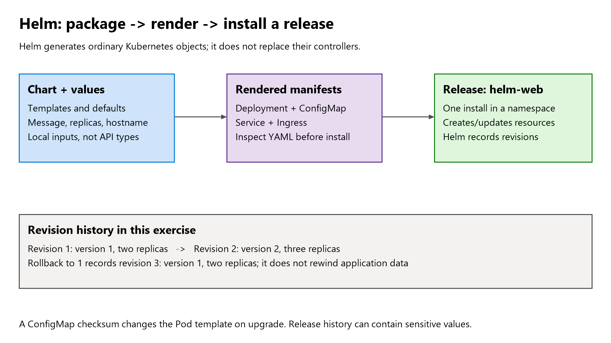
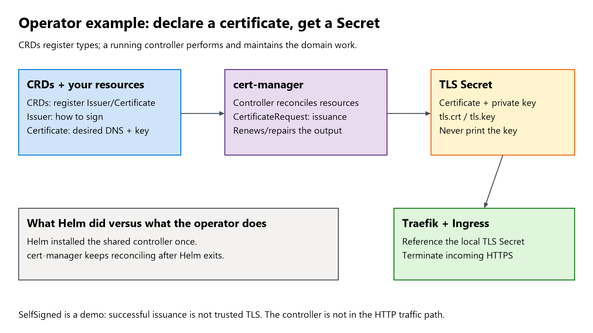

# Helm

**Duration:** 35 minutes, including a 5-minute refresher,
plus an optional 30-minute operator/CRD extension.
**Prerequisites:** [Preparation](00-preparation.md) and
[Service / Ingress / Gateway API](02-service-ingress-gatewayapi.md), including
the shared Traefik controller and `$IngressIp`. In the full workshop, continue
here after [Volumes](03-volumes.md).
Run commands from the workshop root in the same PowerShell session.

## Goals

- Assemble a small chart that creates a Deployment, Service, Ingress and ConfigMap.
- Render templates, install a release, upgrade values and roll back.
- Package the chart.
- Optionally distinguish Helm installation from an operator's reconciliation.

## Concept refresher: Helm packages declarations, not running containers

Helm is a package manager and template engine for Kubernetes applications.
A **chart** contains templates and defaults. Helm combines these with your
chosen values to render ordinary Kubernetes manifests, then installs or updates
them as a tracked **release**.



*Read the picture:* the chart and values are local files, not new Kubernetes
resource types. The output is the Deployment, ConfigMap, Service and Ingress you
already know. Kubernetes controllers, not a permanent Helm process, keep the
installed app running.

### Files, release concepts and Kubernetes objects in this lab

| Item | What it is | In the exercise |
| --- | --- | --- |
| **Chart** | A versioned package of templates, metadata and defaults. | The small `training-web` app package; later packaged as a `.tgz`. |
| **Chart.yaml** | Local chart metadata. | Chart `version` identifies package changes; `appVersion` describes the app version and is not automatically an image override. |
| **values.yaml / `--set`** | Inputs used when rendering templates, not live API objects. | Override replicas, message and hostname without copying manifests. |
| **Templates / helpers** | Files evaluated by Helm's Go template engine. | Generate consistent resource names, labels, backend references and optional Ingress/TLS fields. Kubernetes never sees the `{{ ... }}` expressions. |
| **Release / revision** | One named installation in a namespace and its recorded history. | `helm-web` gets a new revision on install/upgrade/rollback; another installation can use the same chart with different values. |
| **Helm release Secret** | Helm 3's default in-cluster storage for release metadata/history. | Usually named `sh.helm.release.v1.<release>.v<revision>`. Separate from an app Secret; values/manifests can be recoverable by authorized readers. |
| **Deployment -> ReplicaSet -> Pods** | Namespaced Kubernetes workload objects. | The rendered Deployment runs two/three app replicas; Kubernetes manages generated ReplicaSets/Pods. |
| **ConfigMap** | Namespaced non-secret configuration. | Holds the rendered web message; a checksum annotation in the Pod template makes changes trigger a rollout. |
| **Service** | Namespaced stable app endpoint. | Selects this release's Pods using shared name/instance labels. |
| **Ingress** | Namespaced HTTP route declaration. | Uses the existing Traefik IngressClass/controller and the distinct Helm hostname. No new shared controller is installed. |

The raw app and Helm app intentionally have different names and selectors.
Installing a release does not automatically take ownership of existing
`demo` objects, and this chart does not provision storage.

### Understand the workflow before running commands

1. **Lint** checks chart structure/template conventions.
2. **Template** renders YAML locally for inspection. It does not install the app,
   prove server admission succeeds, or test reachability.
3. **Install** creates the release/resources. `--wait` waits for supported
   readiness conditions, not every HTTP/DNS/storage outcome.
4. **Upgrade** reapplies rendered desired configuration and records a revision.
   Here a message change also changes the checksum, causing a Pod rollout.
5. **Rollback** reapplies a previous release configuration and records a new
   revision. It does not reverse database changes, external side effects or
   arbitrary data writes.
6. **Uninstall** removes release-managed resources according to Helm behavior.
   Our raw PVC is not owned by this release; namespace deletion later removes it.

**Docker bridge:** a chart can distribute a parameterized app configuration,
but it is not a container image, Dockerfile or one-to-one Compose replacement.
Helm acts when invoked; operators can continuously reconcile custom resources.

**Recall before typing:** if you edit a local values file, does the running
release change immediately? No; render/check it, then run an upgrade.

## 1. Assemble your chart

Helm templates produce the **same Kubernetes object types** you have just used.
A release is Helm's tracked installation of a chart. It is not a new Kubernetes
workload kind and not a continuously running application-specific operator.

Build a local working chart from the small reference files, or type the
templates yourself using them as the checkpoint solution:

```powershell
$Chart = ".\.work\$Namespace\training-web"
New-Item -ItemType Directory -Path "$Chart\templates" -Force
Copy-Item .\charts\training-web\Chart.yaml $Chart
Copy-Item .\charts\training-web\values.yaml $Chart
Copy-Item .\charts\training-web\templates\* "$Chart\templates"
```

Open the files and trace:

1. Chart name/version in `Chart.yaml`.
2. `replicaCount`, image, message, Service port and Ingress host in `values.yaml`.
3. `{{ .Values.replicaCount }}` in the Deployment.
4. Service selectors using the same helper labels as the Pod template.
5. Ingress backend using the Service's name and port.
6. Conditional Ingress and optional TLS block.
7. `checksum/config` on the Pod template: config changes trigger a rollout.

The chart deliberately does not install shared controllers, CRDs, a PVC or
real credentials. It creates a **separate app**, not an import of the existing
`demo` Deployment into Helm.

## 2. Render before installing

```powershell
helm lint $Chart --strict
helm template helm-web $Chart --namespace $Namespace --set-string "ingress.host=$HelmHost"
```

Inspect the rendered Deployment, ConfigMap, Service and Ingress. Kubernetes
does not understand `{{ ... }}`; Helm resolves those expressions first.

Try rendering without Ingress, then compare the output:

```powershell
helm template helm-web $Chart --namespace $Namespace --set ingress.enabled=false
```

## 3. Install, change and roll back

```powershell
helm install helm-web $Chart --namespace $Namespace `
  --set-string "ingress.host=$HelmHost" --wait --timeout 180s
helm list --namespace $Namespace
kubectl -n $Namespace get deployment,service,ingress,configmap -l app.kubernetes.io/instance=helm-web
curl.exe --fail --noproxy "*" --resolve "${HelmHost}:80:${IngressIp}" "http://${HelmHost}/"
```

Expected: `Hello from Helm - version 1`. There is one shared Traefik but distinct
raw/Helm hostnames, Services and Deployments.

```powershell
helm upgrade helm-web $Chart --namespace $Namespace `
  --set-string "ingress.host=$HelmHost" --set replicaCount=3 `
  --set-string "message=Hello from Helm - version 2" --wait --timeout 180s
kubectl -n $Namespace get deployment helm-web
curl.exe --fail --noproxy "*" --resolve "${HelmHost}:80:${IngressIp}" "http://${HelmHost}/"
helm history helm-web --namespace $Namespace
helm get values helm-web --namespace $Namespace
```

Expected: three replicas and version 2, without a manual rollout restart. The
ConfigMap checksum changed the Pod template.

```powershell
helm rollback helm-web 1 --namespace $Namespace --wait --timeout 180s
kubectl -n $Namespace get deployment helm-web
curl.exe --fail --noproxy "*" --resolve "${HelmHost}:80:${IngressIp}" "http://${HelmHost}/"
```

Expected: two replicas and version 1. Rollback is a **new Helm revision**, not
deletion of the release's history.

**Checkpoint:** package your working chart:

```powershell
helm package $Chart --destination ".\.work\$Namespace"
```

Explain chart version versus image/app version, render versus install, values
versus Kubernetes spec, and why real secrets should not go into release values.

## Completion checkpoint

- Your chart renders a Deployment, Service, Ingress and ConfigMap.
- Release `helm-web` responds through its distinct hostname.
- An upgrade changes replicas/content, and rollback restores both.
- Your packaged chart is in `.work\<your-namespace>`.

You have completed the five-topic core sequence. Continue with the optional
operator extension, or go to [Debrief and cleanup](#debrief-and-cleanup-10-minutes).

## Optional extension: operator and CRD with cert-manager (+30 minutes)

### Concept refresher: extending the API versus packaging an application

An operator combines **custom API resources** with running controllers that
understand a domain. cert-manager understands certificate issuance and renewal.
Helm installs the shared software; cert-manager then reconciles certificate
resources even when no Helm command is running.



*Read the picture:* these are configuration/reconciliation arrows, not a path
through which browser requests travel. Traefik reads the TLS Secret for HTTPS;
it does not ask cert-manager to handle each incoming request.

| Object or component | Scope | Why it matters here |
| --- | --- | --- |
| **CustomResourceDefinition (CRD)** | Cluster | Registers a new type/schema such as `Certificate` in the API. A schema alone does not issue or renew certificates. |
| **Custom resource (CR)** | Defined by its CRD | An instance of the registered type. Your Issuer and Certificate are namespaced CRs, not CRDs. |
| **Issuer `lab-selfsigned`** | Namespace | Describes how certificates are signed. SelfSigned uses the certificate's own key; it does not establish a trusted public certificate authority. |
| **Certificate `demo-tls`** | Namespace | Declares DNS names, key preferences, validity and target Secret; its `issuerRef` selects the Issuer. Its object name and target Secret name happen to match here. |
| **CertificateRequest** | Namespace | Records one issuance request. Created/managed by cert-manager; you inspect it for progress/errors instead of hand-authoring it. |
| **TLS Secret `demo-tls`** | Namespace | Holds the generated certificate and private key (`tls.crt` / `tls.key`). It is a different Secret from the earlier dummy token Secret. |
| **cert-manager Deployments/Pods** | Shared namespace `cert-manager` | Run the controllers, admission webhook and CA injection component. The trainer installs them once; learners do not duplicate them. |
| **Ingress `demo`** | Your namespace | Its TLS block references the local TLS Secret; Traefik consumes it and terminates HTTPS. |

The admission **webhook** validates/mutates requests; it is not the certificate
issuer or traffic proxy. The CA injector helps populate CA bundles used by
configured webhooks/API integrations; it does not make your demo leaf certificate
trusted by browsers. ClusterIssuer is a cluster-scoped alternative to Issuer,
but is deliberately **not used** here.

The controller observes a Certificate, creates issuance requests, writes the
Secret and updates status; later it renews or repairs missing output as needed.
Deleting only your demo TLS Secret while leaving the Certificate demonstrates
this ongoing reconciliation. A `Ready` Certificate proves issuance, not that
clients trust it or that Ingress routing works.

**Recall before typing:** what remains if you install only the CRD without
the controller? The API can store objects of that type, but no certificate
reconciliation happens.

### A. See the installation and extend the API

The trainer shows the **one shared cert-manager Helm installation** from
[Instructor setup](../docs/INSTRUCTOR-SETUP.md). Do not install a copy per learner.
If access permits:

```powershell
helm list --namespace cert-manager
kubectl -n cert-manager get deployments
kubectl get crd certificates.cert-manager.io issuers.cert-manager.io
kubectl api-resources --api-group=cert-manager.io
kubectl explain certificate.spec
```

The trainer can demonstrate the cluster-scoped reads if your role forbids them.

- **CRD:** registers a new API type/schema, for example `Certificate`.
- **CR:** one instance of that type, for example your `demo-tls`.
- **Controller/operator:** watches the desired state and performs domain work.
- A CRD alone would let the API accept an object, but would not issue a cert.
- A Helm chart installed the controller; that controller now reconciles CRs.

### B. Create a namespaced issuer and certificate

```powershell
kubectl -n $Namespace apply -f "$LabFiles\04-operator\issuer.yaml"
kubectl -n $Namespace wait --for=condition=Ready issuer/lab-selfsigned --timeout=120s
kubectl -n $Namespace apply -f "$LabFiles\04-operator\certificate.yaml"
kubectl -n $Namespace wait --for=condition=Ready certificate/demo-tls --timeout=120s
kubectl -n $Namespace describe certificate demo-tls
kubectl -n $Namespace get certificaterequest
kubectl -n $Namespace get secret demo-tls -o custom-columns='NAME:.metadata.name,TYPE:.type'
```

Expected: Certificate Ready and a `kubernetes.io/tls` Secret. You declared the
certificate; you did not manually create its private key or TLS Secret.
Do not dump that Secret's data. The issuer is SelfSigned: no public DNS,
Let's Encrypt account or external service credentials are required.

### C. Observe actual reconciliation

Delete **only your generated demo TLS Secret**, not the Certificate, controller
or CRD:

```powershell
$OldSecretUid = kubectl -n $Namespace get secret demo-tls -o jsonpath='{.metadata.uid}'
kubectl -n $Namespace delete secret demo-tls
kubectl -n $Namespace wait --for=create secret/demo-tls --timeout=120s
kubectl -n $Namespace wait --for=condition=Ready certificate/demo-tls --timeout=120s
$NewSecretUid = kubectl -n $Namespace get secret demo-tls -o jsonpath='{.metadata.uid}'
if (-not $NewSecretUid -or $OldSecretUid -eq $NewSecretUid) { throw 'Expected a newly reconciled Secret.' }
kubectl -n $Namespace describe certificate demo-tls
```

Expected: a new Secret UID. The controller noticed missing actual state and
acted to restore the declared desired state. Certificate reissuance is
asynchronous; inspect conditions, CertificateRequests and events if it fails.

### D. Use the generated TLS Secret with Ingress

The [networking lab](02-service-ingress-gatewayapi.md) restored Ingress and removed
Gateway/HTTPRoute. Apply the HTTPS version:

```powershell
kubectl -n $Namespace apply -f "$LabFiles\04-operator\ingress-tls.yaml"
kubectl -n $Namespace describe ingress demo
curl.exe --fail --insecure --noproxy "*" --resolve "${LabHost}:443:${IngressIp}" "https://${LabHost}/"
```

Expected: the application responds over TLS. `--insecure` is **only for this
self-signed lab certificate**; it disables certificate verification. It does
not establish trusted identity, validate a production trust chain, or belong
in production automation. Normal certificate verification should fail unless
the certificate was explicitly trusted. Never import this demo into the
organization's trust store.

This Ingress explicitly uses Traefik's HTTPS entry point. No HTTP-to-HTTPS
redirect is configured. The Helm app remains on its separate HTTP hostname.
The Certificate controller manages the Secret; Traefik consumes it. These are
two independent controllers cooperating through API objects.

**Checkpoint:** explain why `kubectl apply` succeeded for a Certificate only
after a CRD existed, and why cert issuance still requires a running controller.

## Debrief and cleanup (10 minutes)

Before deletion, inspect your storage. Record the PV name/reclaim policy if you
need the trainer to reclaim it. **Namespace deletion deletes your PVCs**, and
`Delete` policy can destroy the corresponding backend storage.

```powershell
kubectl -n $Namespace get deployment,service,ingress,pvc
helm uninstall helm-web --namespace $Namespace
kubectl delete namespace $Namespace
```

Run namespace deletion only for your own assigned lab namespace after confirming
the data is disposable. Stop port-forward terminals with Ctrl+C.

Do **not** uninstall Traefik, cert-manager, MetalLB or shared CRDs/classes.
Do **not** delete every PV/StorageClass. Static NFS `Retain` PVs and exports need
trainer-owned, targeted cleanup; deleting their PVCs does not remove NFS files.

### Final knowledge check

1. Which controller replaces a deleted application Pod?
2. Why can a Service have no endpoints while all Pods are healthy?
3. Does an Ingress or HTTPRoute implement its own load balancer?
4. What differs between `GatewayClass`, `Gateway` and `HTTPRoute`?
5. When does a ConfigMap update need a restart?
6. What survives Pod deletion, PVC deletion, or namespace deletion?
7. Why does RWO not mean "exactly one Pod"?
8. What does Helm track, and what does an operator reconcile?
9. Is a base64-encoded Secret protected from someone authorized to read it?
10. Why is a successful `curl --insecure` not proof of trusted TLS?

Questions 8 (operator comparison) and 10 can be used as trainer explanations if
you skipped the optional extension.

### Troubleshooting ladder

| Symptom | Inspect first |
| --- | --- |
| API unreachable/Forbidden | Workload context, access path, authentication/RBAC |
| Pod Pending | Pod events, node resources/taints, PVC and topology |
| ImagePullBackOff | Image tag, node registry access, mirror/pull secret |
| CrashLoopBackOff | Logs, previous logs, describe, permissions |
| Service has no endpoints | Matching selectors, Pod readiness, EndpointSlices |
| LoadBalancer address Pending | Existing L4 controller, class/pool selectors and free IPs |
| VIP not reachable | Approved pool/subnet, advertisement, VLAN/routing and firewall |
| Traefik 404 | Host header, class, path, controller and entry point |
| Routing 503 | Backend Service/port, Ready endpoints, app reachability |
| Gateway not Programmed | Class Accepted, listener/entry point, provider logs |
| HTTPRoute not Accepted/ResolvedRefs | Parent listener, hostname, namespace permissions, backend |
| PVC Pending | StorageClass, CSI events; WaitForFirstConsumer may be normal |
| Volume permission denied | UID/GID 101, export ACL/root-squash and CSI fsGroup support |
| Helm upgrade but unchanged content | Correct release/host, rendered values, config checksum and rollout |
| Certificate not Ready | Issuer, webhook health, conditions, CertificateRequests and events |

[Previous: Volumes](03-volumes.md) | [Lab index](../LAB-GUIDE.md)
