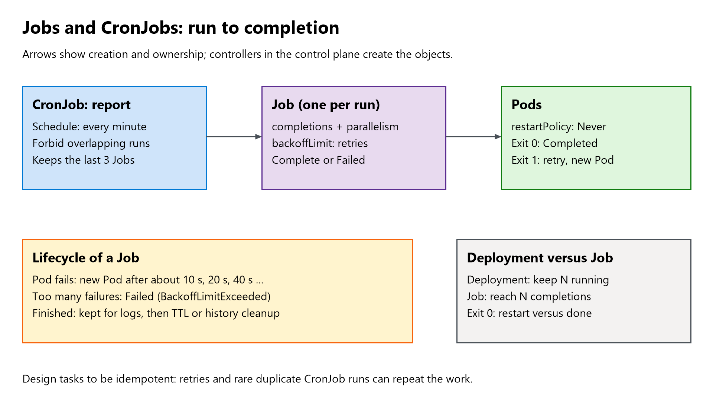

# Jobs and CronJobs

**Duration:** 40 minutes, including a 5-minute refresher.
**Prerequisites:** [Preparation](00-preparation.md). Section 4 also needs the
shared Azure Files claim `demo-shared-data` from [Volumes](03-volumes.md) and
the Ingress with `$IngressIp` from [Service / Ingress / Gateway API](02-service-ingress-gatewayapi.md).
Run commands from the workshop root in the same PowerShell session.

## Goals

- Run a task to completion with a **Job** and read its result.
- Split work across parallel Pods with an **Indexed Job**.
- Observe retries, `backoffLimit` and a failed Job.
- Schedule recurring work with a **CronJob**, trigger it manually and suspend it.

## Concept refresher: run to completion, not forever

A Deployment keeps Pods running: if the process exits, even successfully, it is
restarted. Many tasks are different: a database migration, a nightly export, a
report or a batch computation should **run, finish and stop**. A **Job** runs
Pods until a required number of them finish successfully. A **CronJob** creates
a new Job on a schedule, like one line of a Unix `crontab`.



*Read the picture:* arrows show ownership and creation, not network traffic.
The Job and CronJob controllers in the control plane do the work; the
ownership chain CronJob -> Job -> Pod mirrors Deployment -> ReplicaSet -> Pod.

### Objects you will manipulate or inspect

All objects below are **namespaced**.

| Object | Purpose | In this lab |
| --- | --- | --- |
| **Job** | Runs one or more Pods until the required number of successful completions, then stops. Records succeeded/failed counts and a `Complete` or `Failed` condition. | `hello`, `parallel-batch`, `fail-demo`, `report-manual` |
| **Pod created by a Job** | Does the actual work. Labeled `job-name` / `batch.kubernetes.io/job-name`. Finished Pods stay as `Completed` or `Error` so you can read their logs. | One Pod per attempt or work item |
| **CronJob** | Creates a Job from its `jobTemplate` at each scheduled time. It does not run containers itself. | `report`, every minute |
| **Event** | Records controller actions such as `SuccessfulCreate`, `Completed`, `BackoffLimitExceeded` or `SawCompletedJob`. | Read with `describe` |
| **PVC `demo-shared-data`** | The Azure Files claim from the Volumes lab, mounted by the CronJob's Pods. | Scheduled reports are appended to a shared file |

### Fields that control a Job

| Field | Meaning | Value in this lab |
| --- | --- | --- |
| `restartPolicy` | `Never`: a failed container makes the Job controller create a **new Pod**. `OnFailure`: the kubelet restarts the container **in the same Pod**. `Always` is not allowed in Jobs. | `Never`, so each attempt is a separate Pod with its own logs |
| `completions` / `parallelism` | How many successful Pods are required, and how many may run at the same time. | `1/1` for `hello`; `6` with `2` in parallel for `parallel-batch` |
| `completionMode: Indexed` | Each Pod gets a distinct `JOB_COMPLETION_INDEX` (0 to completions-1) to pick its share of the work. | Six work items, indexes 0-5 |
| `backoffLimit` | Number of retries before the Job is marked `Failed`. Retries wait with an increasing delay (about 10 s, 20 s, 40 s..., capped at 6 minutes). Default 6. | `2` for `fail-demo`: 3 attempts in total |
| `activeDeadlineSeconds` | Hard time limit for the whole Job, whatever the number of retries. | 300-600 s, so nothing runs forever |
| `ttlSecondsAfterFinished` | Deletes the finished Job and its Pods automatically after this delay. | 1800 s (30 minutes), leaving time to inspect |

### Fields that control a CronJob

| Field | Meaning | Value in this lab |
| --- | --- | --- |
| `schedule` | Cron syntax: minute, hour, day of month, month, day of week. `0 2 * * *` = every day at 02:00. | `* * * * *`: every minute, to see results quickly |
| `timeZone` | Time zone used to evaluate the schedule. Without it, the control plane's local time zone is used. | `Etc/UTC` |
| `concurrencyPolicy` | `Allow` (default) runs overlapping Jobs; `Forbid` skips a run while the previous one is active; `Replace` stops the old Job and starts the new one. | `Forbid` |
| `startingDeadlineSeconds` | How late a missed run may still start; later runs are skipped and counted as missed. | 120 s |
| `successfulJobsHistoryLimit` / `failedJobsHistoryLimit` | How many finished Jobs are kept. Defaults 3 and 1. | 3 and 1 |
| `suspend` | Pauses future runs. Jobs already started keep running. | Set to `true` at the end |

### Deployment, Job and CronJob side by side

| | Deployment | Job | CronJob |
| --- | --- | --- | --- |
| Goal | Keep N replicas running | Reach N successful completions | Create a Job for each scheduled time |
| Process exits with code 0 | Container restarted | Counted as a success; Pod stays `Completed` | Handled by the Job it created |
| Allowed `restartPolicy` | `Always` | `Never` or `OnFailure` | `Never` or `OnFailure` in `jobTemplate` |
| Ownership chain | Deployment -> ReplicaSet -> Pod | Job -> Pod | CronJob -> Job -> Pod |
| Docker bridge | `docker run -d --restart always` | A one-off `docker run --rm` task | A host `crontab` line that runs `docker run` |

Rules worth remembering:

- **Make tasks idempotent.** Retries, node failures and rare duplicate CronJob
  runs mean the same work can run twice without harm only if you design for it.
- **A Job runs once.** Re-applying the same Job does not run it again, and its
  Pod template cannot be changed after creation: delete it or use a new name.
  Changing a CronJob only affects Jobs created after the change.
- **Job Pods have no Service.** Results go to logs, storage, a database or a queue.
- **Logs disappear with the Pods.** TTL and history limits delete old Jobs and
  their Pods; ship important output somewhere durable (here, the Azure Files share).

**Recall before typing:** a Job's container exits with code 0. Does Kubernetes
restart it as a Deployment would? No: the Pod is counted as a successful
completion and stays `Completed`.

## 1. Run a one-off Job

```powershell
kubectl -n $Namespace apply -f "$LabFiles\04-jobs\job-hello.yaml"
kubectl -n $Namespace wait --for=condition=Complete job/hello --timeout=180s
kubectl -n $Namespace get job hello
kubectl -n $Namespace get pods -l job-name=hello
kubectl -n $Namespace logs job/hello
kubectl -n $Namespace describe job hello
kubectl -n $Namespace get pods -l job-name=hello -o jsonpath='{.items[0].metadata.ownerReferences[0].kind}{"\n"}'
```

Expected: `COMPLETIONS 1/1`, one Pod in status `Completed` with `0` restarts,
the hello lines in the logs, `SuccessfulCreate` and `Completed` events, and the
owner kind `Job`. The finished Pod stays so you can read its logs; the TTL removes
both the Job and the Pod 30 minutes after completion.

Re-apply the same file:

```powershell
kubectl -n $Namespace apply -f "$LabFiles\04-jobs\job-hello.yaml"
kubectl -n $Namespace get pods -l job-name=hello
```

Expected: `job.batch/hello unchanged` and still a single Pod. Desired state is
already reached: the Job does not run a second time.

## 2. Parallel work with an Indexed Job

```powershell
kubectl -n $Namespace apply -f "$LabFiles\04-jobs\job-parallel.yaml"
kubectl -n $Namespace get pods -l job-name=parallel-batch -w
```

Watch at most **two** Pods `Running` at the same time while new ones start as
others complete. Press Ctrl+C when six Pods are `Completed` (about 45-60 seconds).

```powershell
kubectl -n $Namespace wait --for=condition=Complete job/parallel-batch --timeout=300s
kubectl -n $Namespace get job parallel-batch
kubectl -n $Namespace get pods -l job-name=parallel-batch -L batch.kubernetes.io/job-completion-index
kubectl -n $Namespace logs -l job-name=parallel-batch --prefix
```

Expected: `COMPLETIONS 6/6`, each index from 0 to 5 processed exactly once, and
each log line naming its work item. With `parallelism: 2` the work ran in three
waves; raising parallelism would shorten the Job if the cluster has capacity.

## 3. Failure, retries and `backoffLimit`

```powershell
kubectl -n $Namespace apply -f "$LabFiles\04-jobs\job-fail.yaml"
kubectl -n $Namespace get pods -l job-name=fail-demo -w
```

Watch a new Pod appear after each failure, with a growing delay between attempts.
Press Ctrl+C when three Pods are in `Error` (about 30-60 seconds).

```powershell
kubectl -n $Namespace wait --for=condition=Failed job/fail-demo --timeout=300s
kubectl -n $Namespace get job fail-demo
kubectl -n $Namespace get pods -l job-name=fail-demo
kubectl -n $Namespace describe job fail-demo
kubectl -n $Namespace logs -l job-name=fail-demo --prefix
```

Expected: three Pods (the first attempt plus `backoffLimit: 2` retries), a
`Failed` condition with reason `BackoffLimitExceeded`, and the same error message
in each Pod's logs. With `restartPolicy: OnFailure` you would instead see **one**
Pod whose `RESTARTS` counter increases.

Retrying a deterministic error (bad configuration, missing file) never succeeds;
retries help only with transient failures. Read the logs and fix the cause.

## 4. Schedule work with a CronJob

The CronJob appends a line to `report.txt` on the shared Azure Files volume. The
web app's two replicas mount the same claim, so the report is served by the site.
Check the claim first:

```powershell
kubectl -n $Namespace get pvc demo-shared-data
```

Expected: `Bound`, `RWX`, `azurefile-csi`. If it is missing, complete section 4 of
the [Volumes lab](03-volumes.md) first; otherwise the CronJob's Pods stay `Pending`.

```powershell
kubectl -n $Namespace apply -f "$LabFiles\04-jobs\cronjob-report.yaml"
kubectl -n $Namespace get cronjob report
kubectl -n $Namespace get jobs -l cronjob=report -w
```

A new Job appears at the start of every minute (UTC). Press Ctrl+C after two
Jobs have completed (about two to three minutes). Then inspect:

```powershell
kubectl -n $Namespace get cronjob report
kubectl -n $Namespace get jobs,pods -l cronjob=report
kubectl -n $Namespace logs -l cronjob=report --prefix --tail=5
curl.exe --fail --noproxy "*" --resolve "${LabHost}:80:${IngressIp}" "http://${LabHost}/data/report.txt"
```

Expected: `LAST SCHEDULE` updates every minute; each run is a separate Job named
`report-<number>` with its own Pod; `report.txt` grows by one line per run and is
served through Ingress. A batch workload and a long-running web workload share
data through RWX storage.

Run the CronJob immediately, without waiting for the schedule:

```powershell
kubectl -n $Namespace create job report-manual --from=cronjob/report
kubectl -n $Namespace wait --for=condition=Complete job/report-manual --timeout=180s
kubectl -n $Namespace logs job/report-manual
```

This is how you test a CronJob's `jobTemplate` or re-run a missed execution.

Finally, suspend the schedule so it stops creating Jobs:

```powershell
kubectl -n $Namespace patch cronjob report --type merge -p '{"spec":{"suspend":true}}'
kubectl -n $Namespace get cronjob report
kubectl -n $Namespace get jobs -l cronjob=report
```

Expected: `SUSPEND True` and no new Jobs. At most three successful scheduled Jobs
are kept (`successfulJobsHistoryLimit: 3`); older ones were deleted with their
Pods. If you later set `suspend` back to `false`, the most recent missed run may
start immediately, within the `startingDeadlineSeconds` window.

**Checkpoint:** explain why the web Pods did not need to be restarted to show new
report lines, and what would happen with `concurrencyPolicy: Forbid` if one
report took longer than a minute.

## Completion checkpoint

- `hello` completed 1/1 and re-applying it did not run it again.
- `parallel-batch` completed 6/6 with two Pods at a time and indexes 0-5.
- `fail-demo` failed with `BackoffLimitExceeded` after three Pods.
- The `report` CronJob created a Job every minute, its output was served
  through Ingress, and the schedule is now suspended.

Finished Jobs delete themselves 30 minutes after completion. To remove them now:

```powershell
kubectl -n $Namespace delete job hello parallel-batch fail-demo report-manual --ignore-not-found
```

Keep the suspended CronJob, the web app and `demo-shared-data`; namespace
cleanup at the end of the workshop removes them.

[Previous: Volumes](03-volumes.md) | [Lab index](../LAB-GUIDE.md) | [Next: Helm](05-helm.md)
